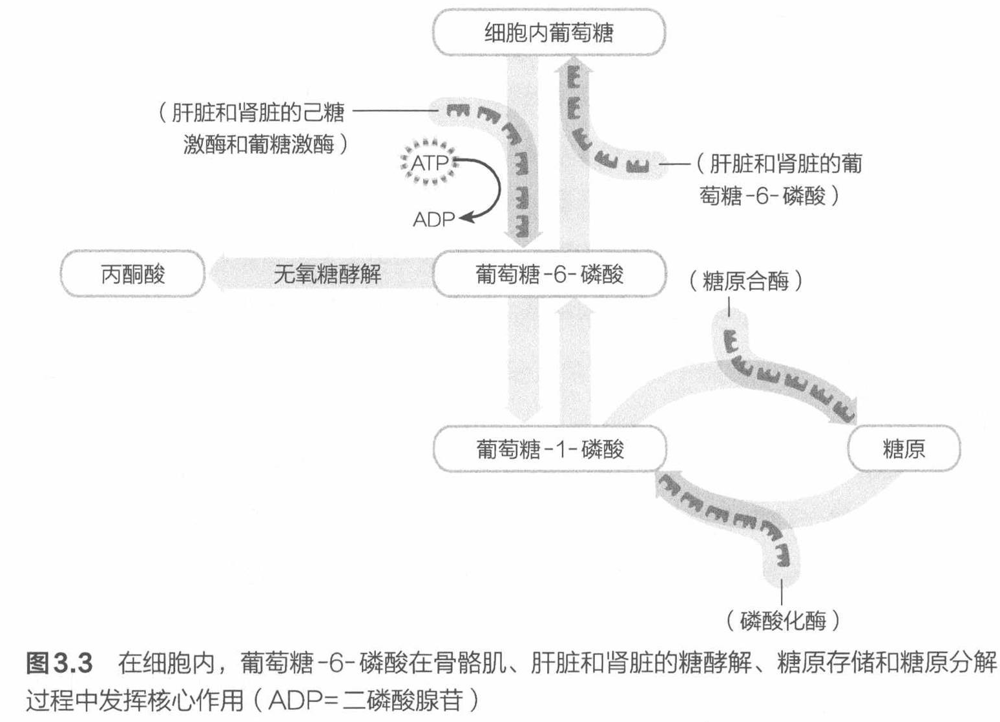
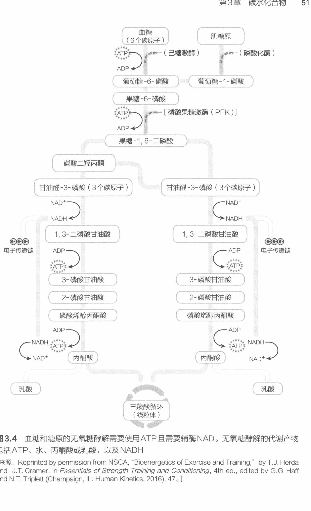

# 糖原分解、糖酵解

## 糖原分解

一旦运动过程中糖原发生分解，这就说明人体需要 ATP 来为骨骼肌收缩提供燃料。ATP 是一种由细胞合成和使用的高能磷酸化合物，用于释放供细胞工作所用的能量。糖原分解的目的是释放葡萄糖（特别是葡萄糖-1-磷酸）化合物，并使葡萄糖进入糖酵解代谢过程，加快 ATP 的生成。

在糖原分解的复杂过程中，糖原分解产生的单个葡萄糖化合物形成葡萄糖-1-磷酸（由磷酸化酶催化而成）。磷酸化酶将糖基残留物从糖原分子的非还原端逐一移除。糖原分解过程中形成的葡萄糖-1-磷酸被磷酸葡萄糖变位酶转化为葡萄糖-6-磷酸。在骨骼肌中，由糖原分解产生的葡萄糖-6-磷酸，与由从血液进入细胞的葡萄糖转化而成的葡萄糖-6-磷酸一起，进入糖酵解代谢过程。肝脏和肾脏的一部分，要么通过糖酵解处理糖原分解产生的葡萄糖-6-磷酸，要么将糖原分解产生的葡萄糖-6-磷酸去磷酸化，然后将这些葡萄糖释放到血液中。在细胞内的葡萄糖代谢过程（例如糖原合成和糖原分解）中，葡萄糖-6-磷酸这种媒介在葡萄糖存储和葡萄糖氧化的各种转化过程中发挥核心作用（见图 3.3）。

图 3.3 在细胞内，葡萄糖-6-磷酸在骨骼肌、肝脏和肾脏的糖酵解、糖原存储和糖原分解过程中发挥核心作用（ADP＝二磷酸腺苷）

## 糖酵解

在运动、高强度训练和比赛中，人体需要快速获得 ATP 以便产生能量。产生 ATP 最快的方式之一就是糖酵解。简而言之，糖酵解就是分解碳水化合物（例如葡萄糖）来产生 ATP 的过程。糖酵解发生在肌肉组织的细胞质中。糖酵解的一个重要生理成果就是能相对较快地生成用于肌肉收缩的 ATP。从图 3.4 中可以看出，

图 3.4 血糖和糖原的无氧糖酵解需要使用 ATP 且需要辅酶 NAD。无氧糖酵解的代谢产物包括 ATP、水、丙酮酸或乳酸，以及 NADH

[来源：Reprinted by permission from NSCA, "Bioenergetics of Exercise and Training," by T.J. Herda and J.T. Cramer, in *Essentials of Strength Training and Conditioning*, 4th ed., edited by G.G. Haff and N.T. Triplett (Champaign, IL: Human Kinetics, 2016), 47.]

糖酵解是一组 10 步酶催化的化学反应链。它的起点是一个含有 6 个碳原子的葡萄糖，终点是两个含有 3 个碳原子的丙酮酸分子。

糖酵解最后产生的丙酮酸可能有两种命运：转变为乳酸或进入线粒体（细胞中负责利用氧产生 ATP 的结构，三羧酸循环、电子传递链和脂肪酸循环均在线粒体内完成）。下一小节将介绍乳酸的产生。进入线粒体的丙酮酸先转化为乙酰辅酶 A，再进入三羧酸循环。三羧酸循环在一系列酶催化的化学反应过程中，进一步使丙酮酸-乙酰辅酶 A 进行代谢。最终，三羧酸循环中的这些化学反应会生成还原型烟酰胺腺嘌呤二核苷酸（NADH）和还原型黄素腺嘌呤二核苷酸（FADH₂），它们会将电子传递给线粒体中的电子传递链。这些电子传递链会促进 ATP 的生成，从而为骨骼肌收缩提供更多燃料。但是与糖酵解生成的 ATP 相比，这种 ATP 生成的速率较慢。了解糖酵解生成 ATP 的速率更快这一点非常重要，特别是在高强度训练或运动中。糖酵解产生大量的丙酮酸，丙酮酸可进一步氧化生成 ATP。这种 ATP 生成方式主要是由葡萄糖分解来促成的，因此确保膳食中含有充足的碳水化合物的必要性也就很容易理解了，这样才能在训练和比赛中为高强度运动提供燃料。

---

- 出处：NSCA《运动营养指南》第 3 章，49~52 页；图 3.3 位于第 50 页，图 3.4 位于第 51 页
