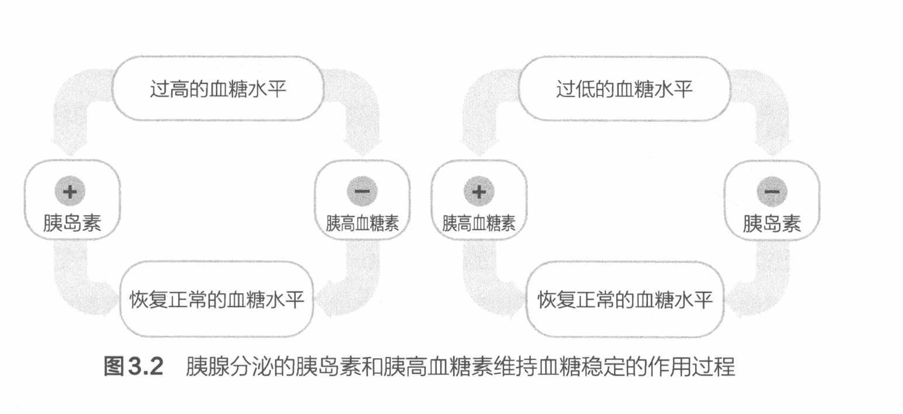

# 血糖稳定

一般情况下，一个成年人体内的总血量大约为 5 升。在这 5 升总血量中，大约有 5 克葡萄糖。从食物中摄取碳水化合物、肝糖原分解和糖异生都有助于保持血糖水平。在禁食阶段，糖异生对血糖水平的保持作用更大。在休息状态下，肌肉内的葡萄糖和糖原使用率很低。血液中胰高血糖素和胰岛素的平衡对血糖和身体组织对糖原的使用率的调节功效最强。当血糖低于正常水平时，胰腺的 α 细胞就会分泌胰高血糖素。胰高血糖素是一种碳水化合物调动激素，其可以促进肝脏的糖异生和肝糖原分解，从而使血糖水平回归正常（见图 3.2）。当血糖水平在进食后超过正常值时，胰腺的 β 细胞就会分泌胰岛素。胰岛素降低血液中葡萄糖的方式有两种，包括增加流向胰岛素敏感的组织（主要是骨骼肌和脂肪组织）的血流量和刺激糖分子扩散到对胰岛素敏感的细胞中去。胰岛素也可以刺激细胞的能量代谢，氧化碳水化合物，促进以糖原的方式存储葡萄糖，并抑制肝脏、骨骼肌的糖原分解和肝脏的糖异生。从训练实践的角度来看，这些系统的正常工作对于保持血糖水平非常重要，因为有氧耐力会随血糖水平的下降而减弱。

图 3.2 胰腺分泌的胰岛素和胰高血糖素维持血糖稳定的作用过程

（手写批注：碳水进入人体只有三个去向——①血糖、②肝糖原、③肌糖原，其中肌糖原只受肌肉收缩调用；获取血糖靠 ①碳水摄取 ②肝糖原分解 ③肝脏糖异生；调节血糖靠 ①胰高血糖素 ②胰岛素。骨骼肌是全身最大的胰岛素敏感器官。）

（手写批注：血糖<正常水平 → α 细胞 → 胰高血糖素 → 促进肝糖原分解／肝脏糖异生；血糖>正常水平 → β 细胞 → 胰岛素 ①流向胰岛素敏感组织的血流↑（骨骼肌、脂肪）②刺激糖扩散进入胰岛素敏感细胞；这些细胞吸收血液中糖分的效率↑。）

---

- 出处：NSCA《运动营养指南》第 3 章，48 页；图 3.2 位于第 49 页
