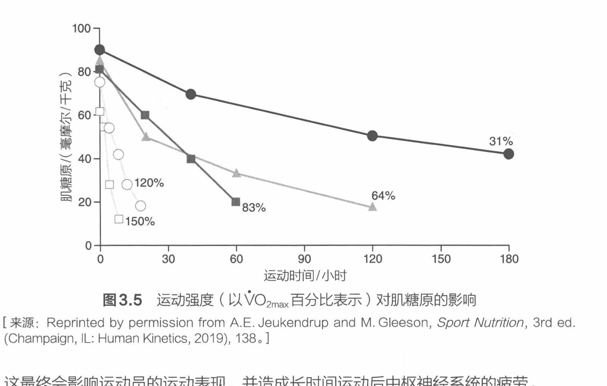

# 运动对碳水化合物存储的影响

在休息状态下和运动过程中，肝脏产生葡萄糖来确保血糖浓度达到 100 毫克/分升（5.5 毫摩尔/升）[43]。血糖大约只能提供参与运动的肌肉所需总能量的 30%，其余所需的碳水化合物燃料来自存储的肌糖原[17]。在长时间高强度运动中，血糖浓度最终会降到正常水平之下，这是因为收缩的骨骼肌在持续消耗血糖，而肝糖原储备也会被不断消耗。

（手写批注：①肌肉收缩消耗肌糖原；②血糖补充肌糖原；③肝糖原补充血糖。）

肝糖原会突然减少，以维持可接受的血糖水平。另外，有氧运动会迅速消耗相对较少的肝糖原。两小时的高强度运动几乎可以耗尽肝脏和参与运动的肌肉中的糖原[18, 67]。如果运动员在运动前已经长时间没有进食，那么糖原消耗将是一个值得特别关注的问题。例如，清晨或者运动热身后，运动员的糖原水平就处于非最佳状态。

（手写批注：无典型碳水化合物摄入（米面）。）

骨骼肌中的糖原是参与运动的肌肉便利的能量来源。碳水化合物的存储量会受饮食和训练状态的影响[2]。糖原的使用速率在很大程度上取决于运动强度（见图 3.5）。当运动强度增加时（例如大于无氧阈或大于最大摄氧量的 80%），即使加快碳水化合物和脂肪在线粒体中的有氧代谢也满足不了肌肉的能量需求。当肌肉组织的 ATP 需求进一步增加，必须通过无氧代谢产生 ATP 时，肌糖原就成为最重要的能量底物。当肌糖原水平随运动的进行下降至低于 30 毫摩尔/千克肌肉的存储量时，人体就会增加对血糖的依赖性，而人体利用血糖作为碳水化合物燃料来源的速率相对较慢。

在运动后期，参与运动的肌糖原水平会下降，这会导致这些肌肉越来越依赖血糖作为其碳水化合物的来源。如果不摄入碳水化合物，那么在肝糖原和肌糖原消耗完后，运动员就很容易出现低血糖症（血糖浓度<45 毫克/分升或 2.5 毫摩尔/升）[64]。

（手写批注：训练效率——增肌期：节约能源、冲刺强度；减脂期：消耗能量。30 毫摩尔/千克 = 30 mmol/kg。）

这最终会影响运动员的运动表现，并造成长时间运动后中枢神经系统的疲劳。

图 3.5 运动强度（以 V̇O2max 百分比表示）对肌糖原的影响

[来源：Reprinted by permission from A.E. Jeukendrup and M. Gleeson, *Sport Nutrition*, 3rd ed. (Champaign, IL: Human Kinetics, 2019), 138.]

在长时间有氧运动中，疲劳主要是参与运动的肌糖原耗竭造成的[60]。即使供氧充足，且脂肪也能提供几乎没有限制的能量，这种现象也会出现。有氧耐力运动员通常把这种类型的疲劳称为"撞墙"现象。血糖明显下降的症状包括虚弱、头晕和运动意愿减弱等。肌糖原减少会导致疲劳感，如果肌糖原进一步减少，人体的运动强度会明显下降，甚至人体会无法进行运动[1, 6]。因此毫无疑问，最佳的有氧耐力表现和运动前的肌糖原存储量之间有直接关系[1, 34]。

注意，无论肌糖原存储量如何，高强度训练中产生的疲劳感都有可能是参与运动的肌纤维及其周边组织内的 pH 值下降造成的。因此，在长时间运动（即时间长于 2 分钟的运动）和高强度间歇性运动（如冲刺练习）中，肌肉中碳水化合物的存储量对于运动表现尤为重要。

高强度间歇性运动包括各种训练课和团队比赛中的多种活动。在高强度间歇性运动的短暂休息期间，肌肉有时间通过清除或缓冲与代谢相关的氢离子来缓解这种副产品的潜在的副作用。此外，极高强度、短时间（如时间短于 10 秒）的运动主要依靠磷酸原能量系统提供的 ATP。值得注意的是，肌糖原在短时间内进行多次高强度间歇性运动的过程中对维持肌肉中 ATP 的含量具有重要作用。

---

- 出处：NSCA《运动营养指南》第 3 章，54~55 页；图 3.5 位于第 55 页
