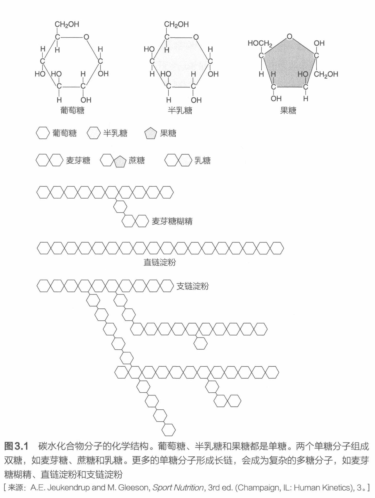

# 单糖、双糖、低聚糖和多糖

## 单糖

人体中有 3 种膳食单糖分子具有与己糖（六碳糖）C₆H₁₂O₆ 一致的分子式，这 3 种单糖是葡萄糖、半乳糖和果糖（见图 3.1）。葡萄糖即血糖，也被称作右旋糖，是人体中最重要、也是人体细胞主要使用的单糖。通过饮食，我们可以很容易地获取这种单糖。人体也可以通过消化和转化其他单糖来合成葡萄糖，或者将葡萄糖从淀粉和糖原等更复杂的碳水化合物分子中释放出来。在糖异生过程中，肝脏会将诸如氨基酸、甘油、丙酮酸和乳酸等化合物转化为葡萄糖。

人体摄入的葡萄糖在被消化后会被小肠吸收，然后进入血液成为细胞新陈代谢的能量来源，或者成为存储在细胞间（主要在肝脏和骨骼肌中）的糖原，或者被肝脏用来转换成脂肪。与葡萄糖相比，半乳糖和果糖的碳原子、氢原子和氧原子的化学链稍有不同。半乳糖是天然存在的，半乳糖一般与葡萄糖结合在一起，形成乳糖。乳糖只存在泌乳人群或动物的乳腺中。肝脏会将食用的半乳糖转化为葡萄糖。果糖是最甜的糖，也被称作左旋糖或水果糖。通常，果糖存在于水果和蜂蜜中。食用果糖被小肠吸收后进入血液，然后被输送到肝脏转化为葡萄糖。在这 3 种单糖中，葡萄糖是最重要的，对于那些锻炼的人群或正在接受训练的运动员来说尤其如此。半乳糖和果糖一旦被小肠吸收，就必须进入肝脏转化为葡萄糖，而这一过程需要花费一些时间。相反，人体直接摄入的葡萄糖可以更容易地被正在工作的肌肉使用。

## 双糖

双糖由两个单糖组成。常见的双糖的结构如图 3.1 所示。常见的双糖包括葡萄糖分子与果糖分子结合形成的蔗糖，与半乳糖分子结合形成的乳糖，以及与另一个葡萄糖分子结合形成的麦芽糖。蔗糖也被称作"餐桌上的糖"，是最常见的膳食双糖。蔗糖在大多数碳水化合物中含量丰富，但在精加工食品中含量尤其丰富。乳糖是甜度最低的双糖。麦芽糖又称饴糖，常见于谷物制品，如谷物和种子食物。虽然麦芽糖包含两个葡萄糖分子，但是它只占日常饮食碳水化合物中的一小部分。单糖和双糖都被称为简单糖。在商业贸易中，这些糖被冠以不同的名称：红糖、玉米糖浆、果子露、糖蜜、大麦芽糖、转化糖、蜂蜜和天然甜味剂等，它们都属于简单糖。

在美国，很多食物和饮料都含有甜味剂，它往往是便宜又好用的高果糖玉米糖浆（high-fructose corn syrup，HFCS）。高果糖玉米糖浆往往被当作一种可以调节果糖浓度的玉米糖浆。HFCS 42 和 HFCS 55 是食品和饮料中最常见的形式。"HFCS"之后的数字代表糖中果糖的百分比（HFCS 42：53% 葡萄糖和 42% 果糖。HFCS 55：42% 葡萄糖和 55% 果糖）[50, 77]。由于高果糖玉米糖浆与甜菜和甘蔗蔗糖的单糖比例相似，因此它具有"甜味"，这为食品和饮料公司提供了成本和制造效益。

（手写批注：运动前：果糖／运动中：佳得乐、尖叫、宝矿力／运动后：植物类多糖（米、面、土豆……）。）

## 低聚糖和多糖

低聚糖是由 3~10 个单糖分子结合在一起构成的。多糖是一种由 10 个至上千个以化学方式链接的单糖分子组成的碳水化合物。多糖来自植物和动物。淀粉和纤维是多糖的植物来源。在人体和动物组织内，葡萄糖的存储形式为糖原。

## 图 3.1

图 3.1 碳水化合物分子的化学结构。葡萄糖、半乳糖和果糖都是单糖。两个单糖分子组成双糖，如麦芽糖、蔗糖和乳糖。更多的单糖分子形成长链，会成为复杂的多糖分子，如麦芽糖糊精、直链淀粉和支链淀粉

[来源：A.E. Jeukendrup and M. Gleeson, *Sport Nutrition*, 3rd ed. (Champaign, IL: Human Kinetics), 3.]

---

- 出处：NSCA《运动营养指南》第 3 章，40~41 页；图 3.1 位于第 42 页
