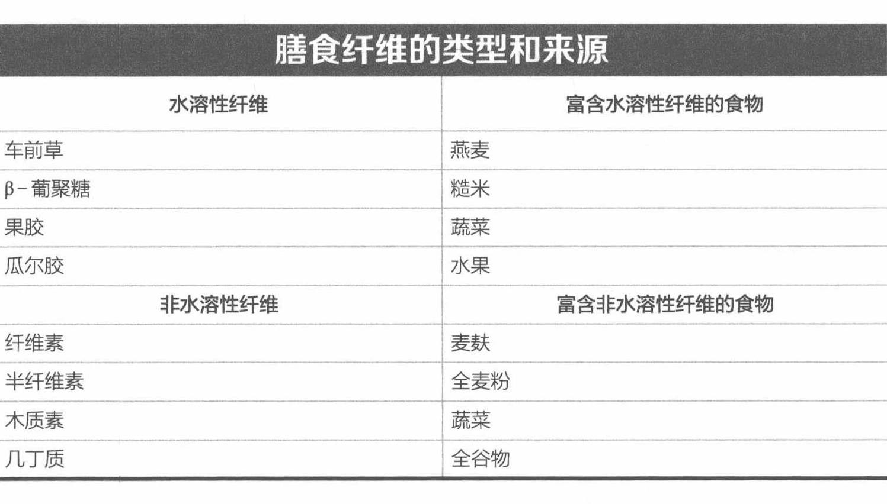

# 淀粉、纤维、糖原

## 淀粉

淀粉是葡萄糖在植物中的存储形式，通常以高浓度的形式存在于植物种子、玉米中，以及存在于用来制作面包、比萨和点心的各类谷物中。另外，豌豆、土豆和其他根茎类蔬菜中也含有淀粉。淀粉有两种形式（见图 3.1）：①直链淀粉，一条又长又直的葡萄糖链扭成一个螺旋线圈；②支链淀粉，一个有很多分支的单糖大分子结构。植物食品中每种淀粉的相对比例决定了该淀粉的消化特性，包括消化率，或者说摄入的食物中可以被人吸收的比例。支链淀粉含量比较高的淀粉更容易被消化，也更容易被小肠吸收。相比之下，直链淀粉含量较高的淀粉不太容易被消化，因此其转化为血糖的速度也就变慢了。"复合糖"通常指的就是食用淀粉。

（手写批注：淀粉转化为肌糖原效率最高。）

## 纤维

纤维是一种结构化以下的非淀粉类多糖。美国国家科学院（National Academy of Sciences，NAS）用以下 3 段文字描述人体对纤维的摄入[36]。

- 膳食纤维由植物中含有的难以消化的碳水化合物和木质素组成，包括不能通过消化系统分解为可吸收物质的淀粉。
- 功能性纤维包含游离的、难以消化的碳水化合物，但是它们对人体有益（肠道细菌能够发酵一小部分水溶性膳食纤维，从而生成短链脂肪酸；这些脂肪酸可以被人体吸收，并用作肠道上皮细胞或白细胞的燃料）[63]。功能性纤维是一种新型纤维分类。功能性纤维这个术语被用来描述一些具有促进人体健康的功效的纤维。功能性纤维不仅包括一些来源于植物的可食用但难以消化的纤维，也包括来源于工业制造的碳水化合物。
- 全纤维是膳食纤维和功能性纤维的总和。

不同纤维的物理特性、化学特性和生理功效大不相同。树叶、树干、根茎、种子和果皮的细胞壁含有不同种类的碳水化合物纤维（纤维素、半纤维素和果胶）。纤维素是地球上最丰富的有机分子（含碳化合物）。通常情况下，膳食纤维分为水溶性膳食纤维和非水溶性膳食纤维，而某些膳食纤维可以从食物中提取出来单独存在并在市场上作为功能性纤维出售。非水溶性纤维包括纤维素和半纤维素。通常情况下，麦麸就是一种富含纤维素的食物。水溶性纤维包括车前草、β-葡聚糖、果胶和瓜尔胶，主要存在于燕麦、黄豆、糙米、豌豆、胡萝卜和很多水果中。因为膳食纤维能够保存大量的水分，所以在肠道中的食物残渣大都是膳食纤维。非水溶性纤维与肠壁上的细胞发生摩擦，有助于改善肠胃功能和肠胃健康状况。而水溶性纤维缩短了食物残渣通过消化道的时间。下面列出了一些水溶性纤维和非水溶性纤维，以及它们各自的食物来源。根据文献报道[73]，通常，美国人每天的饮食会含有 18 克的纤维。这一摄入量远远低于美国国家科学院食品和营养委员会的推荐量，即 38 克/天（男性）和 25 克/天（女性）[36]。

### 膳食纤维的类型和来源

纤维受到研究人员和市场的广泛关注。虽然摄入充足的纤维不会直接影响运动表现，但是有研究发现，高纤维（特别是全谷物纤维）的摄入与心脏和外周动脉疾病、高脂血症（高血脂）、肥胖症、糖尿病和包括肠胃癌在内的消化系统疾病的发病率降低有关[52]。现在有证据表明，膳食纤维在维持健康的肠道菌群多样性方面十分重要，这有助于减少与低纤维饮食习惯相关的慢性疾病和炎症的发生[44, 51]。

## 糖原

糖原是一种由大量葡萄糖组成的带分支的大分子多糖，是碳水化合物在人体内的存储形式。这种形状不规则的支链多糖由成百上千个葡萄糖分子组成。这些葡萄糖分子连接在一起形成致密颗粒。其中也含有一些酶，有些酶负责糖原的合成、分解，或调节与糖原合成、分解有关的过程。糖原的存在使人体在两餐之间拥有大量可以为肌肉收缩供能的碳水化合物储备。

糖原主要存储在肝脏和骨骼肌之中。肝脏中糖原的浓度高，而骨骼肌中的糖原总量大，这是因为骨骼肌分布广、质量大，而肝糖原则是作为储备使用[21]。骨骼肌中的糖原代谢在胰岛素控制血糖稳定的过程中有重要作用。胰岛素是调节血糖水平最重要的物质，可以促进骨骼肌中的血液流动，刺激骨骼肌中的葡萄糖摄取、糖酵解和糖原合成。糖原存储最大化不仅对有氧耐力运动员很重要，对参加高强度训练的运动员也十分重要。第 10 章将探讨在力竭性运动之后使糖原再合成最大化的一些营养策略。

（手写批注：肝脏中的叫肝糖原，骨骼肌中的叫肌糖原。）

（手写批注：运动中：肌糖原↓，血糖补充；血糖↓，肝糖原补充或糖异生。运动后：吃够饭，血糖↑，补充肌糖原，再储存肝糖原。）

---

- 出处：NSCA《运动营养指南》第 3 章，42~45 页
