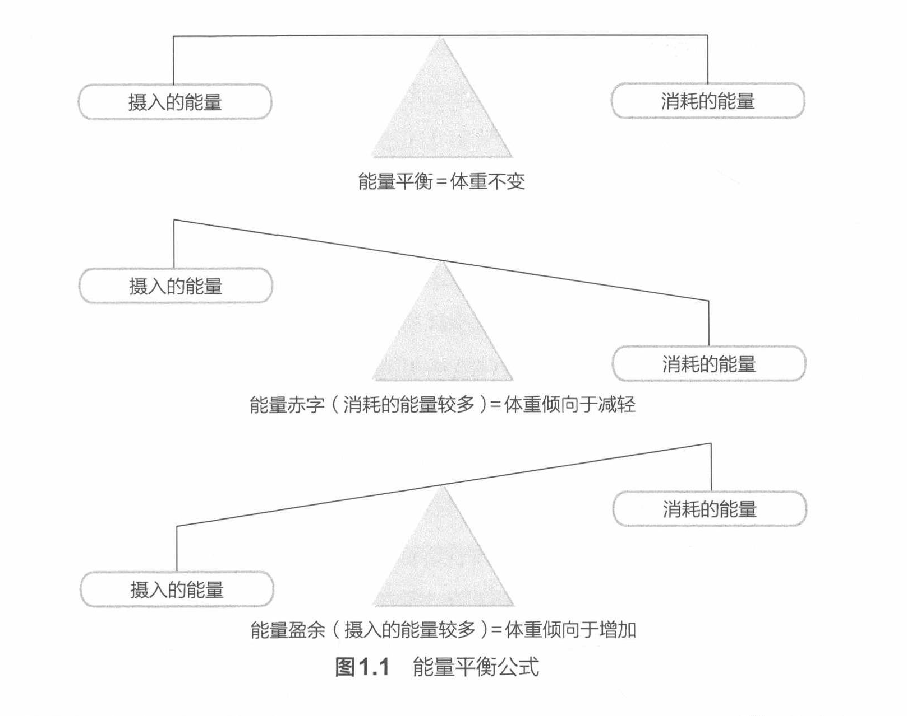

# 能量平衡

人们可以通过改变营养摄入，主要是改变摄入的营养总量和类型，来改变体重和脂肪量。改变体成分最简单的方法就是改变能量平衡公式。根据能量平衡公式，在能量平衡状态下，摄入的能量（即摄入的食物）等于通过正常代谢和活动/锻炼消耗的能量。当运动员处于能量平衡状态时，这意味着他摄入了等热量膳食。等热量膳食指含有维持现有体重所需的日常总能量的膳食。能量平衡通过平衡个体的总能量摄入与总能量消耗（total energy expenditure，TEE）实现。总能量消耗是一天中消耗的总热量，与基础代谢率、食物热效应和运动有关。总能量消耗可能会因人的体形、性别、体成分、基因和体力活动水平而异。

能量平衡公式在体重波动过程中不会总保持在完美的平衡状态。当个体的能量摄入量低于个体的能量消耗量时，个体处于能量赤字状态，体重倾向于减轻。反之，当个体的能量摄入量高于能量消耗量时，个体处于能量盈余状态，体重倾向于增加（见图 1.1）。导致能量赤字的膳食称为低能量膳食或低热量膳食。导致能量盈余的膳食称为高能量膳食或高热量膳食。

图 1.1 能量平衡公式

## 本节子节

- [食物热效应](食物热效应.md)
- [能量限制膳食的不利影响](能量限制膳食的不利影响.md)

---

- 出处：NSCA《运动营养指南》第 1 章，2~3 页；图 1.1 位于第 3 页
